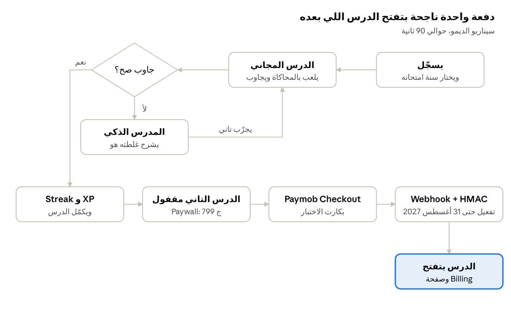

# PRD — لمبة (Lamba)

Oct 24, 2026 · @Abdulbasit

## نظرة عامة

**لمبة (Lamba)** منصة تعلم تفاعلية بالعربي لطلاب الثانوية العامة. بتبسط الفيزيا والكيميا والرياضة والأحياء بمحاكاة الطالب يلعب بيها بإيده، ومدرس AI بيشرح لكل طالب غلطته هو بالظبط. الطالب بيدفع **مرة واحدة** وياخد باقة ساريّة لحد ما امتحانات دفعته تخلص.

**المشكلة:** الطالب بيحفظ القوانين والمعادلات من غير ما يفهم هي بتشتغل إزاي. بيذاكر لوحده بالليل ومفيش حد يقوله غلط فين. والأهل بيدفعوا دروس خصوصي غالية عشان حد «يفهّم» ابنهم.

**ليه دلوقتي:** حوالي 826 ألف طالب امتحنوا ثانوية عامة نظام جديد في 2026، وأكتر من 205 ألف منهم مانجحوش من الدور الأول ([الخليج](https://www.alkhaleej.ae/2026-07-29/منوعات/محطات/نتيجة-الثانوية-العامة-2026-في-مصر-رسوب-أكثر-من-205-آلاف-طالب-الأرقام-الكاملة)). وأدوات الـ AI بقت تقدر تشرح لكل طالب على حسب غلطته، بتكلفة أقل بكتير من الدرس.

**السياق:** المنتج ده بيتبني في Paymob × ALX EdTech Build Night، فرتكال 01 (High-stakes exam prep). القاعدة الثابتة: لازم يكسب فلوس بـ Payment flow شغال على Paymob Sandbox، ولازم دفعة ناجحة لايف قدام الحكام.

## المستخدمين

الطالب هو اللي بيستخدم المنتج، وولي الأمر غالبًا هو اللي بيدفع. عشان كده المنتج لازم يقنع الاتنين.

| الشخصية | مين | محتاج إيه | بيقلق من إيه | إيه اللي يخليه يدفع |
| --- | --- | --- | --- | --- |
| **مريم، الطالبة** | 17 سنة، تالتة ثانوي علمي علوم، بتذاكر بالليل على الموبايل | تفهم الفيزيا مش تحفظها، وحد يقولها غلطت فين | تضيع وقت في حاجة مش هتفرق في الامتحان | تجربة درس مجاني تحس فيه إنها فهمت فعلًا |
| **أ. خالد، ولي الأمر** | موظف، بيدفع دروس في 3 مواد أصلًا | يطمن إن بنته ماشية صح | يدفع مبلغ كبير لمنصة ميعرفهاش | سعر أقل من شهر دروس، وضمان استرجاع 14 يوم |

بيانات الطالب غالبًا بيانات قاصر، فالمستهدف إن ولي الأمر يبقى صاحب الحساب بعد الهاكاثون (شوف قسم القيود والامتثال).

## الأهداف ومقاييس النجاح

هدف الليلة دي: دفعة Sandbox ناجحة لايف بتفتح درس تفاعلي مقفول، وكل ده في ديمو 90 ثانية مابيقعش.

**أهداف الهاكاثون (الليلة دي)**

- [ ] نعدي الـ Payment Gate مع فريق Paymob قبل نهاية البناء
- [ ] دفعة بكارت الاختبار تنجح لايف قدام الحكام، والدرس يتفتح بعدها على طول
- [ ] الـ Tester في Swap-and-test يفهم المنتج من غير شرح، ويقول إنه أو أهله هيدفعوا
- [ ] ننافس على Best Use of AI أو Best Standalone Product

**مقاييس المنتج بعد الهاكاثون**

| المقياس | بيقيس إيه | المستهدف الأولي |
| --- | --- | --- |
| إكمال الدرس المجاني | هل التجربة بتشد الطالب | 60% من اللي بدأوا الدرس |
| التحوّل للدفع | من اللي خلصوا الدرس المجاني للي اشتركوا | 5% |
| التحسن بعد شرح الـ AI | بيجاوب صح في المحاولة التانية بعد الشرح ولا لأ | 70% |
| الاستمرار الأسبوعي | المشترك بيرجع كل أسبوع | 3 أيام في الأسبوع |
| طلبات الاسترجاع | رضا العميل عن الباقة | أقل من 5% |

الأرقام دي فرضيات أولية نراجعها بعد أول تجربة حقيقية.

## النطاق

الليلة دي بنبني **مادة واحدة، وفصل واحد، و3 دروس**: فيزيا تالتة ثانوي، فصل التيار الكهربي وقانون أوم. أي حاجة برا الجدول ده مؤجلة.

| العنصر | الهاكاثون (MVP) | بعد الهاكاثون |
| --- | --- | --- |
| المواد | فيزيا بس | كيميا وأحياء ورياضة |
| الدروس | 3 دروس: الأول مجاني، واتنين ورا الـ Paywall | المنهج كامل، وأولى وتانية ثانوي |
| المحاكاة | محاكاة واحدة متلمّعة: دايرة كهربية بـ Sliders | مكتبة محاكاة لكل فصل |
| المدرس الذكي | شرح الغلطة بناءً على إجابة الطالب واللي عمله في المحاكاة | محادثة مفتوحة، وصوت |
| الأسئلة | أسئلة بنظام الامتحان بيولّدها الـ AI بعد الدرس | امتحانات شاملة، وتشخيص نقط الضعف |
| التحفيز | Streak ونقط XP | تحديات بين الطلاب، ولوحة متصدرين |
| الدفع | دفعة واحدة بالكارت على Sandbox | محافظ إلكترونية، وتقسيط و BNPL على الحساب الحقيقي |
| ولي الأمر | مش موجود | حساب ولي أمر وتقرير أسبوعي |

**إضافات اتقررت:** الـ Onboarding بالأسئلة الأربعة جوه الـ MVP. أنظمة التعليم التانية والبرمجة بعد الهاكاثون، وبتظهر في الـ Onboarding كـ «قريبًا» عشان نقيس الطلب عليها قبل ما نبنيها.

**برا النطاق خالص:** أي عملات أو جواهر أو كريديت بتتباع جوه التطبيق (ممنوعة عند Paymob)، والاشتراك الشهري، وفيديوهات الشرح.

## رحلة المستخدم وسيناريو الديمو

الديمو بيوري لحظتين مهمين: الـ AI وهو بيشرح غلطة الطالب، ودفعة ناجحة بتفتح الدرس اللي بعده. الوقت كله حوالي 90 ثانية.

في الديمو نغلط مرة واحدة مقصودة عشان الحكام يشوفوا شرح الـ AI، وبعدين نجاوب صح ونروح للدفع. ولو فيه وقت، نغيّر التاريخ بالزرار المخفي (F11) عشان يشوفوا السعر بيتغير.

## المتطلبات الوظيفية

أي حاجة P0 لازم تشتغل قبل الـ Payment Gate. P1 لو لحقنا قبل تجميد الفيتشرز. P2 نذكرها في الـ Pitch بس.

| # | المتطلب | التفاصيل | الأولوية |
| --- | --- | --- | --- |
| F1 | التسجيل والدخول | إيميل وباسورد (Supabase Auth)، واختيار «سنة امتحاني» أول مرة | P0 |
| F2 | خريطة الدروس | 3 دروس مترتبة، وقفل ظاهر على الدروس المدفوعة | P0 |
| F3 | محرك الدرس | الدرس = 6 كروت ثابتة: توقّع، ثم مهمة في المحاكاة، ثم شرح، ثم سؤال فكرة، ثم سؤال امتحان، ثم خلاصة (التفاصيل في «دورة الدرس» تحت). المحتوى متخزن JSON | P0 |
| F4 | محاكاة قانون أوم | دايرة بـ Slider للجهد والمقاومة، اللمبة بتنور أكتر أو أقل والأميتر بيتحرك. بتسجل آخر قيم الطالب حطها | P0 |
| F5 | شرح الغلطة بالـ AI | لو الإجابة غلط، الـ AI ياخد السؤال وإجابة الطالب وقيم المحاكاة، ويرد في 3 سطور بالعامية مع تلميح بدون ما يقول الإجابة | P0 |
| F6 | الـ Paywall | لما الطالب يفتح درس مقفول: العرض المتاح حاليًا بسعره وتاريخ نهايته وعدد الشهور | P0 |
| F7 | الدفع على Paymob | Intention ثم Unified Checkout ثم Webhook بـ HMAC ثم تفعيل الباقة (قسم التسعير) | P0 |
| F8 | صفحة Billing | الباقة، «ساري حتى 31 أغسطس 2027»، سجل المدفوعات | P0 |
| F9 | أسئلة بنظام الامتحان | آخر الدرس الـ AI يولّد 3 مسائل جديدة على نفس المفهوم (اختيار من متعدد) للمشتركين بس | P1 |
| F10 | Streak و XP | عداد أيام متتالية ونقط لكل كارت. مش بتتباع ومش بتتصرف | P1 |
| F11 | مبدّل التاريخ للديمو | زرار مخفي بيغيّر «النهارده» (مايو، أكتوبر، مارس) عشان الحكام يشوفوا السعر بيتغير | P1 |
| F12 | صفحات السياسات | About و Privacy و Refund و Return، ورقم تليفون وإيميل وعنوان | P1 |
| F13 | تقرير ولي الأمر | ملخص أسبوعي: الدروس والدقة والـ Streak | P2 |
| F14 | الصوت | المدرس الذكي يتكلم (Web Speech API) | P2 |

### دورة الدرس (6 كروت)

كل درس بيمشي في نفس الدورة، حوالي 6 دقايق. الطالب بيتوقّع ويجرّب الأول، وبعدين نشرح له، عشان الشرح يجاوب على سؤال هو اتسأله.

| # | الكارت | بيعمل إيه | ملاحظات |
| --- | --- | --- | --- |
| 1 | مقدمة + توقّع | جملة تمهيد، وسؤال توقّع من غير درجات: «لو زوّدنا الجهد للضعف، اللمبة هتعمل إيه؟» | حوالي 20 ثانية. التوقّع بيتخزن |
| 2 | مهمة في المحاكاة | هدف محدد: «خلّي التيار 2 أمبير بالظبط»، والحالة بتتحدّث مع كل حركة | الكارت يكمّل لما المهمة تتم |
| 3 | الشرح | بيربط بتوقّع الطالب (صح أو غلط)، وبعدين القانون I = V / R والعلاقة الطردية والعكسية | مثال بأرقام المهمة |
| 4 | اختبر فهمك | سؤال فكرة مش حسابي: «لو المقاومة زادت والجهد ثابت، التيار هيعمل إيه؟» | +10 XP |
| 5 | سؤال امتحان | سؤال بنظام الثانوية العامة، محاولتين | هنا بيشتغل المدرس الذكي |
| 6 | الخلاصة | 3 سطور، والمفاهيم اللي اتفهمت واللي محتاجة مراجعة، و XP و Streak | الدرس التالي أو الـ Paywall |

**لو الإجابة غلط (كارت 4 أو 5):**

1. المدرس الذكي يشرح سبب الغلطة من غير ما يقول الإجابة، ويدّي تلميح.
2. زرار «جرّب في المحاكاة بأرقام السؤال» يفتح المحاكاة بنفس أرقام السؤال.
3. محاولة تانية.
4. لو غلط تاني: الحل خطوة بخطوة، والمفهوم يتعلّم «محتاج مراجعة».

**الإتقان:** المفهوم يتحسب «اتفهم» بس لما الطالب يجاوب صح من غير ما يشوف الحل.

**المراجعة المتباعدة (P2، بعد المسابقة):** سؤالين على المفاهيم اللي محتاجة مراجعة، بعد يوم وبعد 3 أيام.

### متطلبات الـ Onboarding

4 أسئلة قبل إنشاء الحساب، في أقل من دقيقة. كل إجابة بتتسجل في `profiles`، وبتساعدنا نقرر نتوسع في أنهي اتجاه.

| # | الشاشة | التفاصيل | الأولوية |
| --- | --- | --- | --- |
| O1 | الترحيب | اسم لمبة، وجملة «لما الفيزيا تنوّر في دماغك»، و3 مميزات، وزرارين «يلا نبدأ» و «عندي حساب» | P0 |
| O2 | نظام الدراسة | الثانوية العامة (متاح). والبكالوريا المصرية، والثانوية الأزهرية، و IGCSE، والدبلومة الأمريكية، و«نظام تاني» (قريبًا) | P0 |
| O3 | السنة والشعبة | أولى أو تانية أو تالتة ثانوي، وعلمي علوم أو علمي رياضة أو أدبي. سنة الامتحان بتتحسب لوحدها (تالتة ثانوي يعني صيف 2027)، وبتحدد باقة الدفعة | P0 |
| O4 | المواد | الفيزيا متاحة، والباقي قريبًا. والبرمجة (Scratch و Python) مهارة إضافية قريبًا. اختياراته بتتسجل في `interests` | P1 |
| O5 | ولي الأمر | مين هيدفع (أنا أو ولي أمري)، واسم ولي الأمر ورقمه عشان التقرير الأسبوعي. ينفع يتخطى | P1 |
| O6 | قائمة الانتظار | لو اختار نظام غير الثانوية العامة: نسجل موبايله أو إيميله والنظام في `waitlist`، ونعرض عليه يجرّب دروس الثانوية العامة في الوقت ده | P0 |

## التسعير والدفع

بنبيع **باقة دفعة الامتحان**: دفعة واحدة بالكارت، والباقة ساريّة لحد آخر امتحانات دفعة الطالب، بما فيها الدور التاني. مفيش اشتراك شهري. السعر بيتحدد بميعاد الشراء، وتاريخ النهاية ثابت لكل دفعة.

**نوافذ الأسعار لدفعة 2027** (الأرقام مبدئية)

| وقت الشراء | الباقة | السعر (جنيه) | المبلغ لـ Paymob (قرش) | سارية حتى |
| --- | --- | --- | --- | --- |
| 1 مايو – 31 أغسطس 2026 | حجز مبكر (early\_bird) | 699 | 69900 | 31 أغسطس 2027 |
| 1 سبتمبر 2026 – 28 فبراير 2027 | السنة كاملة (full\_year) | 799 | 79900 | 31 أغسطس 2027 |
| 1 مارس – 31 يوليو 2027 | المراجعة النهائية (final\_revision) | 399 | 39900 | 31 أغسطس 2027 |

النهارده (24 أكتوبر 2026) العرض المتاح هو «السنة كاملة» بـ 799 ج، وده اللي هيظهر في الديمو لو مغيّرناش التاريخ.

**قواعد الباقة**

- الطالب بيختار سنة امتحانه أول مرة، وده بيحدد الدفعة وتاريخ النهاية.
- العرض المعروض = نافذة السعر اللي النهارده جواها. والـ Paywall بيعرض عدد الشهور المتبقية محسوب من النهارده.
- بعد الدفع: `current_period_end` = تاريخ نهاية الدفعة، مش «النهارده + 365».
- ضمان استرجاع كامل خلال 14 يوم، ومكتوب في سياسة الاسترجاع.
- التقسيط و BNPL مش متاحين في الـ Sandbox. بنذكرهم في الـ Pitch كخطوة بعد ما نشتغل على الحساب الحقيقي.

**تدفق Paymob**

1. الفرونت يبعت `POST /api/checkout` ومعاه سنة الدفعة. السيرفر هو اللي بيحدد الباقة والسعر من التاريخ، مش الفرونت.
2. السيرفر يعمل Payment Intention بالـ Secret key: المبلغ بالقرش، و EGP، والـ Card Integration ID، و billing\_data، و `special_reference = userId:cohort:plan:timestamp`، و notification\_url، و redirection\_url ([الدوكس](https://developers.paymob.com/paymob-docs/developers/intention-apis/create-intention)).
3. نحوّل الطالب لصفحة [Unified Checkout](https://developers.paymob.com/paymob-docs/developers/checkout-experiences/unified-checkout-redirection) بالـ Public key والـ client\_secret.
4. الـ Webhook يتحقق من الـ HMAC، ولو العملية نجحت يسجل الدفعة ويفعّل الباقة. لازم يبقى Idempotent على رقم العملية، عشان نفس الإشعار لو وصل مرتين ميتحسبش مرتين.
5. صفحة الـ Redirection تتحقق من الـ HMAC وتعرض «اشتراكك ساري حتى 31 أغسطس 2027»، وبعدها ترجّع الطالب للدرس اللي كان عايز يفتحه.

## البزنس موديل

لمبة بيكسب من مصدرين دلوقتي ومصدرين بعدين: الطالب بيدفع باقة دفعته في الـ MVP، والسناتر والمدارس بتدفع ترخيص سنوي عشان تشرح بالمحاكاة. وبعد كده بنتوسع لأنظمة تعليم تانية ولمسار برمجة.

| مصدر الدخل | مين بيدفع | بيدفع على إيه | التسعير | المرحلة |
| --- | --- | --- | --- | --- |
| B2C · باقة الدفعة | الطالب أو ولي الأمر | كل الدروس والمدرس الذكي لحد آخر امتحان | 699 / 799 / 399 ج (قسم التسعير) | MVP |
| B2B · السناتر | صاحب السنتر | المدرس يشرح بالمحاكاة في الحصة، وطلاب السنتر ياخدوا حسابات | ترخيص سنوي بعدد الطلاب: \[يتحدد بعد مقابلات مع سناتر\] | بعد الهاكاثون |
| B2B · المدارس | المدرسة | «وضع الفصل»: المدرس يعرض المحاكاة على البروجيكتور، ولوحة متابعة للفصل | ترخيص سنوي لكل فصل أو لكل طالب: \[يتحدد\] | بعد الهاكاثون |
| التوسع · أنظمة تانية | الطالب | البكالوريا المصرية، والأزهرية، و IGCSE، والدبلومة الأمريكية | نفس موديل باقة الدفعة | حسب أرقام قائمة الانتظار |
| التوسع · البرمجة | الطالب أو المدرسة | مسار برمجة بـ Scratch وبعدين Python، بنفس أسلوب المحاكاة والمدرس الذكي | \[يتحدد\] | بعد البكالوريا |

**ليه السناتر والمدارس:** عقد واحد بيوصّلنا لعدد كبير من الطلاب مرة واحدة، فتكلفة جذب الطالب بتقل. والمدرس بيبقى شريك بيستخدم المحاكاة في شرحه، مش منافس. والعقود دي بتتدفع بفاتورة سنوية، فمش محتاجة Subscriptions من Paymob.

**ليه البرمجة:** في البكالوريا المصرية، البرمجة مادة في أولى ثانوي خارج المجموع ([أخبار اليوم](https://akhbarelyom.com/news/newdetails/4527631/1/))، وفي تانية ثانوي في مسار الهندسة وعلوم الحاسب الطالب بيختار بين الكيمياء والبرمجة ([اليوم السابع، مايو 2026](https://www.youm7.com/story/2026/5/28/لطلاب-أولى-ثانوى-كل-ما-تريد-معرفته-عن-مسار-الهندسة/7430780)). المصادر دي مابتقولش الوزارة هتعتمد أنهي لغة، فاختيار Scratch للبداية و Python بعدها قرار مننا، ونراجعه أول ما المنهج ينزل.

**قائمة الانتظار بتقرر التوسع:** أي نظام تعليم يجمع أكتر أسماء في الـ Onboarding هو اللي نبدأ بيه بعد الثانوية العامة.

## المعمارية التقنية

تطبيق ويب واحد بـ Next.js (App Router) و TypeScript و Tailwind، والواجهة عربي RTL ومتظبطة على الموبايل الأول. الداتا والتسجيل على Supabase (Postgres + Auth)، والنشر على Cloudflare Workers من أول نص ساعة عشان الـ Webhook محتاج URL عام. الـ Webhook بتاع Paymob بيبقى Supabase Edge Function (`paymob-webhook`) جنب الداتابيز، وتسجيل الدفعة بيحصل في دالة Postgres واحدة (`record_payment`) عشان يبقى Idempotent. الـ AI بيتنادى من السيرفر بس، ومفيش مفاتيح في الفرونت.

**الأدوات:** Supabase للداتا والتسجيل، و Claude Code للبناء، و Cloudflare للنشر. وده اللي بيختلف في Cloudflare:

- Next.js بيتنشر على Cloudflare Workers عن طريق OpenNext، والنشر بيتم من الـ CLI بـ wrangler ([دليل النشر](https://makerkit.dev/docs/next-supabase-turbo/cloudflare)).
- المفاتيح السرية بتتحط بـ `wrangler secret put` أو من إعدادات Workers، وعلى الجهاز في ملف `.dev.vars` أو `.env.local`. ومفاتيح الـ Edge Function بـ `supabase secrets set`.
- التحقق من الـ HMAC بتاع Paymob بـ Web Crypto (`crypto.subtle`)، أو بتفعيل `nodejs_compat`.
- دليل النشر بيقول إن خطة Workers المجانية ممكن متكفيش حجم تطبيق Next.js كبير، فنتأكد من حجم الـ Build بتاعنا بدري.

**نموذج البيانات**

| الجدول | أهم الأعمدة | ملاحظات |
| --- | --- | --- |
| profiles | id, name, education\_system, grade, track, exam\_cohort, payer, parent\_phone, xp, streak, last\_active\_date | سنة الامتحان بتتختار أول مرة |
| lessons | id, subject, chapter, order, is\_free, content (JSON) | المحتوى متخزن هنا، مش في الكود |
| attempts | user\_id, lesson\_id, card\_id, answer, is\_correct, sim\_state (JSON), prediction, hints\_used, ai\_feedback | بيغذّي مقياس التحسن بعد الشرح |
| progress | user\_id, lesson\_id, concept, mastered, review\_due | mastered = جاوب صح من غير ما يشوف الحل |
| subscriptions | user\_id, cohort, plan, status, current\_period\_end | صف واحد لكل طالب |
| payments | id, user\_id, paymob\_transaction\_id (unique), amount\_cents, plan, success, raw (JSON) | الـ unique هو اللي بيمنع التفعيل مرتين |

**جداول جديدة للـ Onboarding:** `waitlist` (contact, education\_system, created\_at) لقائمة الانتظار، و `interests` (user\_id, subject) للمواد اللي الطالب اختارها وهي لسه مش متاحة.

الدفعات ونوافذ الأسعار في ملف إعدادات واحد (`COHORTS`)، فيه تاريخ نهاية كل دفعة ونوافذها.

**الـ APIs**

| Endpoint | بيعمل إيه |
| --- | --- |
| `GET /api/offer` | العرض المتاح حاليًا لدفعة الطالب: الباقة، والسعر، وتاريخ النهاية، وعدد الشهور |
| `POST /api/checkout` | يعمل Payment Intention ويرجّع رابط Unified Checkout |
| `POST {SUPABASE_URL}/functions/v1/paymob-webhook` | Supabase Edge Function: يتحقق من الـ HMAC، ويسجل الدفعة بـ `record_payment`، ويفعّل الباقة |
| `GET /billing/result` | يتحقق من الـ HMAC ويعرض النتيجة |
| `POST /api/tutor/explain` | شرح الغلطة بالـ AI (F5) |
| `POST /api/practice/generate` | مسائل جديدة بنظام الامتحان (F9)، للمشتركين بس |

**متغيرات البيئة:** `PAYMOB_SECRET_KEY` · `PAYMOB_PUBLIC_KEY` · `PAYMOB_CARD_INTEGRATION_ID` · `PAYMOB_HMAC_SECRET` · `AI_API_KEY` · `APP_URL` · مفاتيح Supabase.

## تصميم الـ AI

الـ AI بيشرح غلطة **الطالب ده بالذات**، لأنه شايف هو حط إيه في المحاكاة. ده اللي بيفرّقنا عن منصات المحتوى الثابت وعن ChatGPT، وده اللي ننافس بيه على Best Use of AI.

**1. شرح الغلطة (F5)**

- **المدخل:** نص السؤال، والإجابة الصح، وإجابة الطالب، وقيم المحاكاة (مثلًا V = 12 فولت، R = 6 أوم)، وملخص الدرس.
- **المخرج (JSON):** `{ "diagnosis": "اللي فهمته غلط", "hint": "تلميح من غير الإجابة", "try_in_sim": "جرّب تحط … وشوف اللمبة" }`
- **القواعد:** بالعامية المصرية، والمصطلحات العلمية زي ما هي في كتاب الوزارة. 3 سطور بحد أقصى، مايقولش الإجابة النهائية، ويربط الشرح باللي الطالب يقدر يجربه في المحاكاة.

**2. مسائل بنظام الامتحان (F9)**

- **المدخل:** المفهوم، ومثالين من أسئلة امتحانات سابقة بنكتبهم بإيدينا.
- **المخرج (JSON):** 3 أسئلة، كل واحد فيه السؤال و4 اختيارات ورقم الإجابة الصح والحل خطوة بخطوة.

**الحماية من الأخطاء**

- السيرفر يتأكد إن شكل الـ JSON صح. ولو فشل، يعيد مرة واحدة، وبعدها يرجع لشرح جاهز مكتوب مسبقًا لكل سؤال.
- في المسائل المتولّدة الكود بيحسب الناتج بنفسه بقانون أوم ويقارنه بإجابة الـ AI، والمسألة اللي مش مظبوطة ماتظهرش.
- نخزّن ردود أشهر 3 غلطات في كل سؤال (Cache) عشان الديمو يبقى سريع حتى لو النت بطيء.

## القيود والامتثال

أكبر قيد إن Paymob بيرفض أي بيع جوه اللعب. عشان كده المنتج اسمه «منصة تعلم تفاعلية»، مش «لعبة»، والدفع بيفتح محتوى لمدة محددة وبس.

**قواعد Paymob** (من عرض الإيفنت)

- ممنوع: Gaming monetization، وبيع Tokens أو Credits بتتصرف على خدمات، و Dropshipping. الـ XP والـ Streak عندنا مش بتتباع ولا بتتصرف.
- الـ Sandbox بيدعم الدفع مرة واحدة بالكارت بس: مفيش Subscriptions ولا تقسيط ولا BNPL ولا Split payouts.
- التسجيل كتاجر بالبطاقة بس مينفعش معاه موديل اشتراك. الباقة بتاعتنا دفعة واحدة، بس لازم نسأل فريق Paymob هل بتتحسب اشتراك (في الأسئلة المفتوحة).
- الـ MCP بيشتغل على الحساب الحقيقي بس، فمش هنعتمد عليه الليلة دي.

**متطلبات الموقع عشان نشتغل لايف بعدين** (نعملها الليلة دي لو لحقنا، F12)

- رقم تليفون وإيميل وعنوان (ممكن يبقى العنوان اسم المدينة بس)، وصفحة About Us.
- سياسات: الخصوصية، والاسترجاع، والإرجاع. ممكن نكتبها بالـ AI، بس لازم تبقى منطقية وواضحة.
- أسعار حقيقية، مش أرقام عشوائية.

**بيانات القُصّر**

- أغلب الطلاب تحت 18 سنة. بعد الهاكاثون ولي الأمر هيبقى صاحب الحساب اللي بيدفع وبيوافق على استخدام البيانات.
- بنجمع أقل داتا ممكنة: الاسم الأول، والإيميل، وسنة الامتحان. ومبنبعتش للـ AI أي بيانات شخصية، السؤال والإجابة بس.

## خطة البناء في 4 ساعات

الدفع يتبنى الأول ويشتغل من الأول للآخر قبل نص الوقت. بعدها نحط الدروس ورا الـ Paywall. الوقت محسوب من بداية نافذة البناء.

1. **0:00 – 0:30 · التجهيز:** التسجيل في Paymob وناخد الـ Keys، ونسجل الحساب في فورم الإيفنت بنفس البيانات. نقفل الفكرة في Standup 1، ونعمل الـ Repo وننشر أول نسخة على Cloudflare Workers (`npm run deploy`)، وننشر الـ Edge Functions على Supabase.
2. **0:30 – 1:45 · البناء بالتوازي:** كل واحد على مساره (الجدول تحت). نخلص المرحلة دي لما دفعة Sandbox تنجح وتفعّل الباقة.
3. **\~1:45 · Standup 2:** نقول إيه الشغال وإيه الواقف، ونطلب دعم Paymob لو فيه مشكلة في الدفع.
4. **1:45 – 2:40 · الربط:** الدرسين المدفوعين ورا الـ Paywall، والـ AI جوه الدرس، والـ Streak. وفي نفس الوقت Swap-and-test، ونكتب إجابات الـ Tester.
5. **2:40 · تجميد الفيتشرز:** مفيش حاجة جديدة. نصلّح الأخطاء بس، ونكتب سكريبت الديمو، ونسجّل فيديو احتياطي لعملية دفع كاملة.
6. **\~3:15 · Payment Gate:** نراجع الـ Checklist مع فريق Paymob.
7. **3:30 – 4:00 · البروفة:** بروفتين للـ Pitch بتايمر 6:30، ونجهز إجابات الأسئلة.

| الدور | مسؤول عن | المتطلبات |
| --- | --- | --- |
| A · الدفع والباك إند | Claude Code، و Supabase، و Paymob، والنشر | F1, F6, F7, F8, F11 |
| B · الـ AI | البرومبتات، وشكل الـ JSON، والـ Cache | F5, F9 |
| C · الدروس والمحاكاة | محرك الكروت، ومحاكاة قانون أوم، ومحتوى التلت دروس | F2, F3, F4, F10 |
| D · الـ Pitch والبزنس | الـ Deck على Template بتاع ALX، والسوق، والمنافسين، وصفحات السياسات، وهو اللي يروح الـ Swap-and-test | F12 |

## المخاطر والأسئلة المفتوحة

أكبر مخاطرة إن الوقت يضيع في المحتوى والشكل والدفع ميبقاش شغال. عشان كده الدفع هو P0 الأول.

| المخاطرة | هنتعامل معاها إزاي |
| --- | --- |
| الفرتكال 01 يتملى (3 فرق) في Standup 1 | البديل: نفس المنتج لفرتكال 03، المدرس بيستخدم المحاكاة في الفصل |
| الـ Webhook مش واصل | الـ Edge Function على Supabase ليها URL عام من الأول، والنشر على Cloudflare Workers من الأول، وصفحة الـ Redirection تتحقق من الـ HMAC وتفعّل الباقة كخطة احتياطية |
| رد الـ AI بطيء أو غلط وقت الديمو | الـ Cache لأشهر الغلطات، وشرح جاهز مكتوب مسبقًا، والكود بيراجع الناتج بقانون أوم |
| المحاكاة بتاخد وقت أكتر من المتوقع | محاكاة واحدة متلمّعة بس، والدرسين التانيين كروت وأسئلة من غير محاكاة جديدة |
| النت يقع وقت العرض | فيديو احتياطي متسجل، وهوتسبوت من موبايل |
| الحكام يشوفوها «لعبة» | اللغة في المنتج وفي الـ Pitch: «منصة تعلم تفاعلية»، ومفيش حاجة بتتباع جوه التطبيق |
| قيمة العميل محدودة لأنه بيدفع سنة واحدة | نتوسع لأولى وتانية ثانوي (3 سنين لكل طالب)، وتكلفة جذب الطالب منخفضة عن طريق ترشيح الطلاب لبعض والسناتر |

**الأسئلة المفتوحة**

- [x] اسم المنتج اتقفل: لمبة (Lamba)
- [ ] نسأل فريق Paymob: الباقة اللي بتتدفع مرة واحدة بتتحسب «اشتراك» لو سجلنا بالبطاقة بس؟
- [ ] الأسعار النهائية (699 / 799 / 399 مبدئية)
- [ ] تاريخ نهاية دفعة 2027 بعد ما جدول الامتحانات والدور التاني يتعلن (مفترض 31 أغسطس)
- [ ] مين هيراجع دقة المحتوى العلمي مقابل كتاب الوزارة بعد الهاكاثون

**المصادر**

- [عرض Paymob × ALX Build Night](https://claude.ai/code/artifact/7025000a-db99-4a89-88ec-67ecdfe341df) (قواعد الإيفنت، وشرايح Paymob، والـ Pitch Template)
- [Paymob: Create Intention](https://developers.paymob.com/paymob-docs/developers/intention-apis/create-intention)
- [Paymob: Unified Checkout](https://developers.paymob.com/paymob-docs/developers/checkout-experiences/unified-checkout-redirection)
- [الخليج: نتيجة الثانوية العامة 2026](https://www.alkhaleej.ae/2026-07-29/منوعات/محطات/نتيجة-الثانوية-العامة-2026-في-مصر-رسوب-أكثر-من-205-آلاف-طالب-الأرقام-الكاملة)
